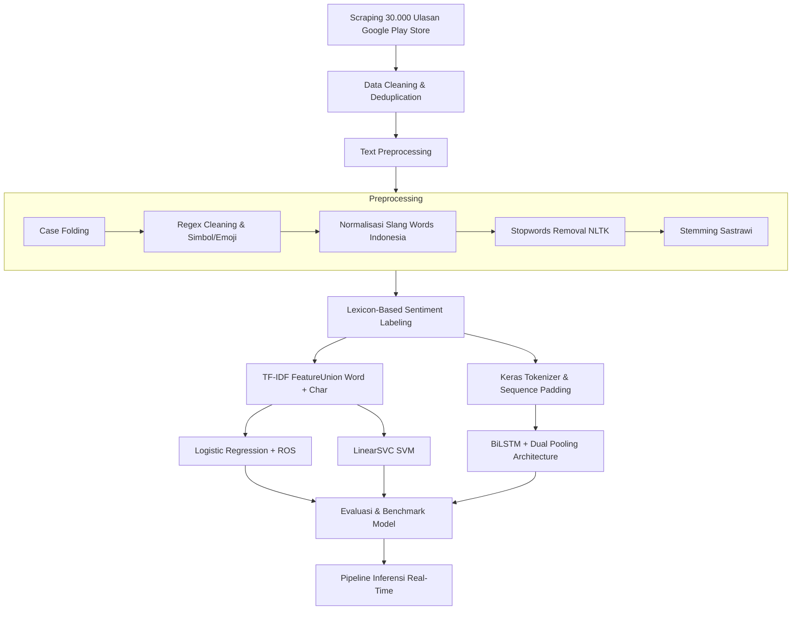

# 🎬 Analisis Sentimen Ulasan Disney+ Hotstar Indonesia

[](https://www.python.org/)
[](https://www.tensorflow.org/)
[](https://scikit-learn.org/)
[](https://play.google.com/store/apps/details?id=com.disney.disneyplus)
[]()
[](LICENSE)

Proyek ini merupakan implementasi **End-to-End Sentiment Analysis** terhadap **30.000 ulasan** pengguna aplikasi **Disney+ Hotstar Indonesia** yang diambil langsung dari Google Play Store. Proyek ini membandingkan algoritma *Machine Learning* klasik (**Logistic Regression** dan **LinearSVC**) dengan arsitektur *Deep Learning* modern (**Bidirectional LSTM + Dual Pooling Attention**) untuk mengklasifikasikan sentimen menjadi 3 kategori: **Negatif**, **Netral**, dan **Positif**.

---

## 📌 Ringkasan Hasil & Benchmark Model

Semua model dievaluasi menggunakan metrik *Accuracy*, *Precision*, *Recall*, dan *F1-Score* untuk setiap kelas sentimen. Model **BiLSTM** menghasilkan performa tertinggi dengan akurasi melampaui **93%**.

| Model | Setup & Split | Akurasi (%) | Macro F1 | Weighted F1 | Status Target (≥85%) |
| :--- | :---: | :---: | :---: | :---: | :---: |
| 🏆 **BiLSTM + Dual Pooling** | 80% Train : 20% Test | **93.23%** | **0.91** | **0.93** | ✅ Tercapai |
| 🥈 **Logistic Regression (Optimized)** | 70% Train : 30% Test + ROS | **89.25%** | **0.86** | **0.89** | ✅ Tercapai |
| 🥉 **LinearSVC / SVM (Optimized)** | 80% Train : 20% Test | **87.62%** | **0.83** | **0.87** | ✅ Tercapai |

### Detail Performa per Kelas (BiLSTM Model)
- **Negatif** (3,544 data uji): Precision: `0.97` | Recall: `0.96` | F1-Score: `0.96`
- **Netral** (1,279 data uji): Precision: `0.83` | Recall: `0.87` | F1-Score: `0.85`
- **Positif** (1,104 data uji): Precision: `0.94` | Recall: `0.91` | F1-Score: `0.93`

---

## 📊 Dataset & Distribusi Sentimen

Data ulasan diekstraksi dari **Google Play Store Indonesia** (`com.disney.disneyplus`) menggunakan pustaka `google-play-scraper`.

- **Total Ulasan Mentah**: 30.000 baris
- **Total Ulasan Pasca-Pembersihan**: 29.634 baris
- **Metode Pelabelan**: *Lexicon-Based Scoring* (Kamus Bahasa Indonesia Positif & Negatif)

| Kategori Sentimen | Jumlah Ulasan | Persentase |
| :--- | :---: | :---: |
| 🔴 **Negatif** | 17.718 | 59.8% |
| ⚪ **Netral** | 6.393 | 21.6% |
| 🟢 **Positif** | 5.523 | 18.6% |

---

## 🛠️ Alur Pipeline (End-to-End Architecture)



### Arsitektur Model BiLSTM:
1. **Embedding Layer**: Kosakata 15.000 kata unik, dimensi embedding 128.
2. **Layer BiLSTM 1**: 64 unit, `return_sequences=True`, dropout 0.3, recurrent dropout 0.1.
3. **Layer Normalization**: Stabilisasi gradien selama training.
4. **Layer BiLSTM 2**: 32 unit, `return_sequences=True`.
5. **Feature Fusion (Dual Pooling)**: Kombinasi `GlobalAveragePooling1D` + `GlobalMaxPooling1D` untuk menangkap fitur representatif global dan konteks lokal terkuat.
6. **Dense & Softmax**: 3 unit output (`Negative`, `Neutral`, `Positive`).

---

## 📁 Struktur Repositori

```text
analisis-sentimen-disneyplus/
├── disneyplus_reviews_raw.csv           # Dataset mentah 30.000 ulasan Play Store
├── requirements.txt                      # Daftar dependensi & versi pustaka
├── ScrappingDataDisneyPlus.ipynb         # Notebook scraping ulasan Google Play Store
├── PelatihanModelAnalisisSentimen.ipynb  # Pipeline preprocessing, training, & tuning model
├── InferensiModelAnalisisSentimen.ipynb  # Pipeline inferensi teks tunggal & batch
├── .gitignore                            # Konfigurasi file yang diabaikan Git
└── README.md                             # Dokumentasi proyek
```

---

## 🚀 Panduan Instalasi & Penggunaan

### 1. Clone Repositori
```bash
git clone https://github.com/JayJung666/analisis-sentimen-disneyplus.git
cd analisis-sentimen-disneyplus
```

### 2. Buat & Aktifkan Virtual Environment
```bash
# Windows
python -m venv venv
venv\Scripts\activate

# macOS / Linux
python3 -m venv venv
source venv/bin/activate
```

### 3. Instal Dependensi
```bash
pip install -r requirements.txt
```

### 4. Menjalankan Notebook
Jalankan Jupyter Notebook atau buka di Google Colab:
```bash
jupyter notebook
```
- **Langkah 1**: Buka `ScrappingDataDisneyPlus.ipynb` jika ingin mengambil data ulasan terbaru dari Play Store.
- **Langkah 2**: Buka `PelatihanModelAnalisisSentimen.ipynb` untuk melatih model Logistic Regression, LinearSVC, atau BiLSTM.
- **Langkah 3**: Buka `InferensiModelAnalisisSentimen.ipynb` untuk melakukan prediksi sentimen pada teks ulasan baru.

---

## 💡 Contoh Inferensi Prediksi

```python
# Contoh pengujian kalimat baru pada pipeline inferensi:
contoh_ulasan = [
    "Disney Plus benar-benar luar biasa! Kontennya sangat lengkap dan gambarnya jernih.",
    "Aplikasi ini sangat mengecewakan. Sering error, tidak bisa login, dan CS tidak membantu.",
    "Aplikasinya lumayan, harga langganannya standar seperti platform streaming lain."
]

# Prediksi Model BiLSTM:
# [1] -> Sentimen: Positif  (Confidence: 98.4%)
# [2] -> Sentimen: Negatif  (Confidence: 99.1%)
# [3] -> Sentimen: Netral   (Confidence: 89.7%)
```

---

## 🧰 Teknologi yang Digunakan

- **Bahasa Pemrograman**: [Python 3.10+](https://www.python.org/)
- **Data Scraping**: [google-play-scraper](https://github.com/JoMingyu/google-play-scraper)
- **Pemrosesan Teks & NLP**:
  - [Sastrawi](https://github.com/harisal/sastrawi) (Stemmer Bahasa Indonesia)
  - [NLTK](https://www.nltk.org/) (Stopwords removal & tokenisasi)
- **Machine Learning & Deep Learning**:
  - [TensorFlow / Keras](https://www.tensorflow.org/) (BiLSTM Deep Neural Network)
  - [scikit-learn](https://scikit-learn.org/) (Logistic Regression, LinearSVC, GridSearch)
  - [imbalanced-learn](https://imbalanced-learn.org/) (RandomOverSampler)
- **Visualisasi**: Matplotlib, Seaborn, WordCloud

---

## 👤 Penulis

- **GitHub**: [@JayJung666](https://github.com/JayJung666)

---

## 📄 Lisensi

Proyek ini dirilis di bawah lisensi [MIT License](LICENSE).
